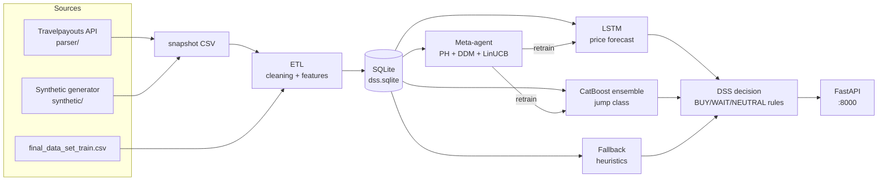
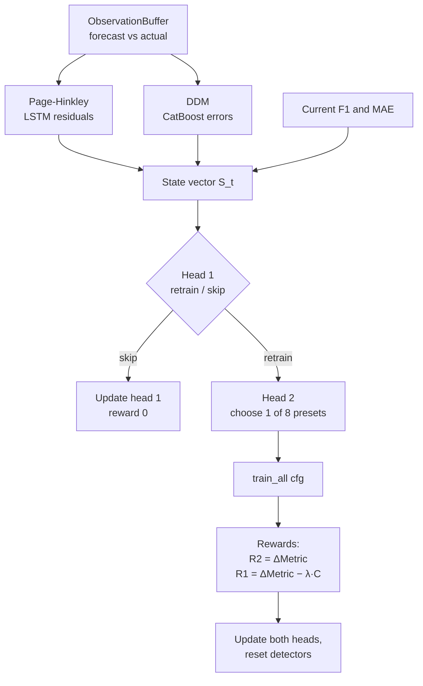

# Hybrid_ticket_reccomend_system
# Hybrid Ticket Recommend System

**A hybrid decision support system (DSS) for airfare purchase decisions.**

The system tracks ticket prices and, for every ticket option, answers the user's question: *buy now or wait?* The recommendation (`BUY` / `WAIT` / `NEUTRAL`) combines two models:

- **LSTM**: regression forecast of the price 2 steps ahead;
- **CatBoost ensemble**: classification of the expected price jump (stable / moderate rise / sharp jump).

On top of them runs a **control module**. It monitors model degradation with concept-drift detectors (Page-Hinkley, DDM) and decides *when* and *how* to retrain the models using a two-headed **LinUCB** contextual bandit. When models are unavailable, the system switches to a **fallback mode** driven by price-history heuristics.

Developed as part of a master's thesis at Lipetsk State Technical University.

---

## Contents

- [Architecture](#architecture)
- [How a decision is made](#how-a-decision-is-made)
- [Control module (meta-agent)](#control-module-meta-agent)
- [Installation](#installation)
- [Running](#running)
- [REST API](#rest-api)
- [Configuration](#configuration)
- [Data](#data)
- [Database](#database)
- [Project structure](#project-structure)
- [Auxiliary scripts](#auxiliary-scripts)
- [Known limitations](#known-limitations)

---

## Architecture



Real and synthetic data follow the same path: **source → snapshot CSV → ETL → SQLite → models → recommendation**.

| Layer | Modules | Purpose |
|---|---|---|
| Data collection | `parser/travelpayouts.py`, `synthetic/generator.py` | Fetch prices from the Aviasales/Travelpayouts API or generate synthetic data |
| ETL | `etl/snapshot_loader.py`, `etl/data_cleaner.py`, `etl/feature_builder.py` | Load snapshot files, remove outliers, build leakage-free features |
| Storage | `db.py` | SQLite schema, connections, model version registry |
| ML | `ml/lstm_model.py`, `ml/catboost_model.py`, `ml/training.py` | Model training and inference |
| Decisions | `dss/decision.py`, `dss/fallback.py`, `dss/candles.py` | Recommendation rules, fallback, chart data |
| Control | `control/meta_agent.py`, `control/linucb.py`, `control/drift_detector.py`, `control/observation_buffer.py` | Drift detection and adaptive retraining |
| API | `main.py` | FastAPI application |
| Startup | `cold_start.py` | DB initialization, data ingestion, training, server start |

---

## How a decision is made

### Models

**LSTM v2.1** (`ml/lstm_model.py`, TensorFlow/Keras)
- Target: the ratio `p[t+2] / p[t]`, converted back to rubles.
- Architecture: `LSTM(64) → Dropout(0.2) → LSTM(32) → Dropout(0.2) → Dense(16, relu) → Dense(1)`.
- Window: 14 observations (tunable through the meta-agent presets).
- Loss: weighted Huber loss that penalizes errors on jumps more heavily, with weight `1 + 10·|y − 1|`.
- Split: 70/15/15 **by ticket** (not by time), early stopping on `val_loss`.
- Features: current price, lags 1–3, 3-day rolling mean and std, EMA-3/EMA-7, momentum, acceleration, RSI-7, sine/cosine of day of week, days until departure, time slot, flight duration, USD rate, one-hot direction.
- Metrics: MAE and RMSE in rubles, R², direction accuracy, compared against a naive "last price" baseline.

**CatBoost Ensemble** (`ml/catboost_model.py`)
- 15 `MultiClass` classifiers with different seeds, depth (3–5), `l2_leaf_reg` and `bagging_temperature`; probabilities are averaged.
- Classes by absolute price change `|Δ%|`:

  | Class | Name | Condition |
  |---|---|---|
  | 0 | `stable_or_drop` | `|Δ%| ≤ 0.1` |
  | 1 | `moderate_jump` | `0.1 < |Δ%| ≤ 3.0` |
  | 2 | `high_jump` | `|Δ%| > 3.0` |

- Synthetic rows are down-weighted (`synthetic_weight = 0.4`); class weighting modes are `balanced` and `boost_jump`.
- Main metric: macro-F1 on the test set, compared against "dominant class" and "persistence" baselines.

### Recommendation rules (`dss/decision.py`)

An LSTM signal counts as **significant** only if the forecast change in rubles exceeds `0.5 × MAE` of the model. Otherwise the forecast is within model error and is treated as neutral. A CatBoost signal is used when its class probability is ≥ 0.35. "Price near minimum" means no more than 5% above the historical minimum.

| # | Condition | Decision | Confidence |
|---|---|---|---|
| 1 | CatBoost: class 2 **and** LSTM: rise or neutral | `BUY` | `min(p × 1.4, 0.95)` |
| 2 | CatBoost: class 1 **and** LSTM: significant rise (≥ 0.1%) | `BUY` | `p × 0.9` |
| 3 | Price near minimum **and** CatBoost: class 0 **and** LSTM does not forecast a drop | `BUY` | 0.65 |
| 4 | CatBoost: class 0 **and** price above minimum | `WAIT` | `p × 0.95` |
| 5 | Price near minimum **and** LSTM: significant drop | `WAIT` | 0.70 |
| 6 | Otherwise: signals conflict or are weak | `NEUTRAL` | 0.50 |

Every response includes a text explanation (`reasoning`), forecasts from both models, price history statistics and model trust metadata.

### Fallback mode (`dss/fallback.py`)

Activates when there are no active models (first run, failed training) or when one of the models fails at inference. The decision is based on where the current price sits within its historical range:

| Price position | Decision |
|---|---|
| ≤ 15th percentile of range | `BUY` |
| ≥ 85th percentile of range | `WAIT` |
| Fewer than 5 observations | `NEUTRAL` |
| Within ±10% of the mean | `NEUTRAL` |
| Below / above the mean | weak `BUY` / `WAIT` |

If one of the models still works, a hybrid mode (`lstm_only` / `catboost_only`) is used with reduced confidence. The mode and the reason are returned in the `fallback` field of the API response.

---

## Control module (meta-agent)

`control/meta_agent.py` implements a two-headed adaptive retraining scheme.



**State vector** `S_t = ⟨PH_t, p_t, Δ_t, N_t, F1_t, MAE_t, 1⟩`: Page-Hinkley statistic, DDM error rate, drift magnitude, normalized number of new observations, current model metrics and a bias term.

**LinUCB** (`control/linucb.py`): `UCB_a(x) = xᵀθ̂_a + α·√(xᵀA_a⁻¹x)`, where `θ̂_a = A_a⁻¹b_a`. The `A_a` matrices and `b_a` vectors are serialized into the `bandit_state` table, so the bandit state survives restarts.

**Head 1, "when to retrain"**: actions `{retrain, skip}`, reward `ΔMetric − λ·C` (retraining cost `C = 0.02`).

**Head 2, "how to retrain"**: 8 predefined configurations, reward `ΔMetric`, where `ΔMetric = ΔF1 + 0.5 · ΔMAE_norm`.

| Preset | History window | LSTM lookback | LSTM LR | Ensemble size | Class weights |
|---|---|---|---|---|---|
| `preset_default` | all | 14 | 5e-4 | 15 | balanced |
| `preset_recent` | 30 days | 14 | 5e-4 | 10 | balanced |
| `preset_long_lookback` | all | 20 | 5e-4 | 15 | balanced |
| `preset_short_lookback` | all | 8 | 5e-4 | 15 | balanced |
| `preset_boost_jumps` | all | 14 | 5e-4 | 20 | boost_jump |
| `preset_low_lr` | all | 14 | 2e-4 | 15 | balanced |
| `preset_aggressive` | 30 days | 10 | 1e-3 | 8 | balanced |
| `preset_stable` | 60 days | 14 | 2e-4 | 25 | balanced |

All decisions, states and retraining results are logged to the `control_logs` and `retrain_events` tables.

---

## Installation

Requirements: **Python 3.10+**.

> **Important: package layout.** The code imports its modules as the `app` package (`from app.config import ...`), so the repository must be cloned into a folder named `app`. The `data/` and `models/` directories and the `dss.sqlite` file are created one level up, next to `app/`.

```bash
mkdir dss && cd dss
git clone -b test https://github.com/FANDIM-wolf/Hybrid_ticket_reccomend_system.git app

python -m venv .venv
source .venv/bin/activate          # Windows: .venv\Scripts\activate

pip install fastapi "uvicorn[standard]" pydantic pandas numpy scikit-learn \
            tensorflow catboost requests joblib matplotlib
```

After the first run the layout looks like this:

```
dss/
├── app/                 ← this repository
├── data/                ← snapshot CSVs and final_data_set_train.csv
├── models/
│   ├── lstm/            ← model_<version>.keras + meta JSON
│   └── catboost_ensemble/
└── dss.sqlite
```

---

## Running

Run all commands from the parent folder (`dss/`).

### Cold start

```bash
python -m app.cold_start
```

`cold_start` performs five steps:
1. creates the DB schema (idempotent);
2. checks the data: at least 100 observations and at least 3 unique tickets are required;
3. if there is not enough data, ingests it: first `data/final_data_set_train.csv`, otherwise generates synthetic data (`DSS_DATA_MODE=synthetic`) or uses parser snapshot files (`real`);
4. if there are no active models, trains the LSTM and the CatBoost ensemble;
5. starts FastAPI at `http://127.0.0.1:8000`.

| Flag | Action |
|---|---|
| `--rebuild` | Fully reload data and retrain models |
| `--check-only` | Only check data integrity (exit code 0/1) |
| `--no-serve` | Prepare data and models without starting the server |

Quick start without real data:

```bash
DSS_DATA_MODE=synthetic python -m app.cold_start --rebuild
```

### API only

If data and models are already in place:

```bash
uvicorn app.main:app --host 127.0.0.1 --port 8000
```

Interactive Swagger docs: `http://127.0.0.1:8000/docs`.

### Collecting real data

```bash
export TRAVELPAYOUTS_TOKEN=<your_token>
export DSS_DATA_MODE=real
curl -X POST http://127.0.0.1:8000/parser/run   # collect snapshot files
curl -X POST http://127.0.0.1:8000/etl/run      # load them into the DB
```

---

## REST API

| Method | Path | Description |
|---|---|---|
| `GET` | `/health` | System status, data mode, observation count, whether fallback is active |
| `GET` | `/tickets` | List of tickets with a short summary |
| `GET` | `/ticket/{option}` | Ticket card |
| `GET` | `/ticket/{option}/history?limit=500` | Price time series |
| `GET` | `/ticket/{option}/candles?limit=60` | Daily OHLC candles |
| `GET` | `/recommend/{option}` | **Main endpoint**: `BUY`/`WAIT`/`NEUTRAL` recommendation |
| `GET` | `/models/status` | Versions and metrics of active models |
| `GET` | `/control/state` | Meta-agent and bandit state |
| `GET` | `/control/logs?limit=50` | Control module log |
| `GET` | `/control/retrain_events` | Retraining history |
| `POST` | `/retrain` | Force retraining through the meta-agent |
| `POST` | `/parser/run` | Run the Travelpayouts parser (`DATA_MODE=real` only) |
| `POST` | `/etl/run` | Run ETL on accumulated snapshot files |

Example `/recommend/{option}` response (values are illustrative):

```json
{
  "option_name": "MOW-AER_...",
  "current_price": 8450.0,
  "recommendation": "BUY",
  "confidence": 0.72,
  "reasoning": "CatBoost predicts sharp price jump (class 2) with probability 51%. ...",
  "lstm": { "pred_rub": 8910.4, "delta_pct": 5.45, "version": "..." },
  "catboost": { "class": 2, "class_name": "high_jump", "proba": {"0": 0.21, "1": 0.28, "2": 0.51}, "version": "..." },
  "price_history": { "min": 7900.0, "max": 11200.0, "mean": 9120.5, "percentile": 16.7 },
  "model_trust": { "lstm_mae": 532.0, "catboost_f1": 0.485, "...": "..." },
  "fallback": null
}
```

---

## Configuration

All settings live in `config.py`. Some of them can be overridden with environment variables:

| Variable | Default | Purpose |
|---|---|---|
| `DSS_DATA_MODE` | `real` | Data source: `real` or `synthetic` |
| `TRAVELPAYOUTS_TOKEN` | — | Travelpayouts API token |
| `FALLBACK_PRICE_MIN_PCT` | `15.0` | Percentile for `BUY` in fallback |
| `FALLBACK_PRICE_MAX_PCT` | `85.0` | Percentile for `WAIT` in fallback |
| `FALLBACK_NEUTRAL_ZONE_PCT` | `10.0` | Neutral zone around the mean, % |
| `FALLBACK_MIN_OBSERVATIONS` | `5` | Minimum observations for the heuristic |

Key constants in `config.py`:
- **parser routes**: 15 routes from Moscow (AER, KRR, KZN, LED, NQZ, OVB, SVX, KGD, MRV, IST, ALA, EVN, GYD, TAS, DXB), departure month `PARSER_DEPARTURE_MONTH`;
- **LSTM**: `LSTM_SEQ_LEN=14`, `LSTM_HORIZON=2`, `LSTM_EPOCHS=100`, `LSTM_BATCH_SIZE=32`;
- **class thresholds**: `JUMP_THRESHOLD_STABLE=0.1`, `JUMP_THRESHOLD_HIGH=3.0`;
- **detectors**: `PH_DELTA=0.005`, `PH_LAMBDA=0.05`, `DDM_WARNING_LEVEL=2.0`, `DDM_DRIFT_LEVEL=3.0`;
- **bandit**: `LINUCB_ALPHA=1.0`, `RETRAIN_COST=0.02`;
- **DSS**: `DSS_CATBOOST_CONFIDENCE_BUY=0.35`, `DSS_LSTM_GROWTH_BUY=0.1`.

---

## Data

### Sources

1. **`data/final_data_set_train.csv`**: a prepared dataset that takes priority during cold start and training. Required columns: `direction`, `option`, `best_price`, `observation_date` (or `date`).
2. **Travelpayouts parser**: endpoint `aviasales/v3/prices_for_dates`, market `ru`, currency `rub`. Files are saved to `data/prices_for_dates/<month>/oneway/<ORIG>_<DEST>/snapshot_*.csv`. Each flight's `ticket_key` is an MD5 hash of direction, departure date, airline and flight number.
3. **Synthetic generator**: 20 routes × 180 days × 2 observations per day. Three carrier profiles (`aeroflot_like`, `utair_like`, `pobeda_like`), a U-shaped booking-horizon curve, calendar effects and heavy-tailed noise (Student-t). Files are written to `data/synthetic/`.

### ETL (`etl/`)

1. `snapshot_loader`: finds and merges snapshot files for the current mode.
2. `data_cleaner`: drops rows whose flight number does not match the route and price outliers (> 3σ per ticket).
3. `feature_builder`: features are built **on the shifted price** `p.shift(1)` to prevent target leakage: lags, rolling statistics, EMA, RSI, momentum, acceleration, cyclical day-of-week encoding and the `jump_class` label.

---

## Database

SQLite (`dss.sqlite`), WAL mode, no ORM.

| Table | Contents |
|---|---|
| `observations` | Post-ETL observations: price, features, outbound/return flight details |
| `predictions` | Model forecasts and the actual price (filled in later) |
| `residuals` | LSTM residuals and CatBoost correctness, input for drift detectors |
| `models_meta` | Model version registry, file paths, metrics, active flag |
| `bandit_state` | Serialized `A_a`, `b_a` for every arm of both heads |
| `retrain_events` | Retraining log: metrics before/after, rewards, duration |
| `recommendations` | Issued recommendations |
| `decision_logs` | Log of `/recommend` requests |
| `control_logs` | Meta-agent log: drift checks, head decisions |

Manual initialization: `python -m app.db`.

---

## Project structure

```
app/
├── config.py               # global configuration
├── main.py                 # FastAPI application
├── db.py                   # SQLite schema and helpers
├── cold_start.py           # entry point: init → training → server
├── admin_start.py          # admin panel launcher (see limitations)
├── parser/
│   └── travelpayouts.py    # Travelpayouts API client
├── synthetic/
│   └── generator.py        # synthetic price generator
├── etl/
│   ├── snapshot_loader.py
│   ├── data_cleaner.py
│   └── feature_builder.py
├── ml/
│   ├── lstm_model.py       # LSTM v2.1
│   ├── catboost_model.py   # CatBoost ensemble
│   └── training.py         # TrainConfig, train_all()
├── dss/
│   ├── decision.py         # BUY/WAIT/NEUTRAL rules
│   ├── fallback.py         # heuristic mode
│   └── candles.py          # history and OHLC candles
└── control/
    ├── meta_agent.py       # two-headed meta-agent
    ├── linucb.py           # LinUCB with persistent state
    ├── drift_detector.py   # Page-Hinkley and DDM
    └── observation_buffer.py
```

---

## Auxiliary scripts

The scripts in the root folder are not part of the running system. They are research experiments and maintenance utilities. Most of them expect CSV files (`train_lstm.csv` and others) in the current folder, which are not included in the repository.

| Script | Purpose |
|---|---|
| `check_db.py` | DB diagnostics: list of tables and their structure |
| `clear_db.py` | Clears the `observations` table |
| `analyze.py`, `static_analyze.py` | Exploratory and statistical dataset analysis |
| `time_predictor_train.py` | Standalone LSTM experiment on `direction + departure_date` series |
| `full_train.py`, `simple_data.py`, `simple_with_plots.py` | Early LSTM experiments |
| `simple_catboost.py`, `create_catboost_dataset.py` | Early CatBoost experiments, builds `train_catboost.csv` |
| `simple_forest.py` | Random Forest baseline |
| `jump_price.py` | Counts flights with price changes |
| `change_data_in_db.py` | Deletes half of the observations and **overwrites model metrics in `models_meta` with hard-coded values**. After running it, `/models/status`, `model_trust` and the LinUCB rewards no longer reflect the real model quality. Do not use when evaluating results. |

---

## Known limitations

- **The admin panel is missing from this branch.** `admin_start.py` launches `admin.admin_app:app`, but there is no `admin/` module in the repository.
- **No `requirements.txt`**: dependencies are listed in [Installation](#installation).
- **The Travelpayouts token** has a default value in `config.py`. For real use, set your own via `TRAVELPAYOUTS_TOKEN`.
- `/control/state` creates a new `MetaAgent` instance on every request. The bandit state is loaded from the DB, but drift detector statistics live only in memory, so the response reflects a fresh instance.
- The meta-agent does not run on a schedule: retraining is triggered via `POST /retrain` or from code (`MetaAgent().tick()`).
- CORS is open to all origins (`allow_origins=["*"]`). This is fine for a prototype, but not for production.

---

## Tech stack

Python · FastAPI · Uvicorn · Pydantic · SQLite · pandas · NumPy · scikit-learn · TensorFlow/Keras · CatBoost · Requests

## Author

Mikhail Shishov
